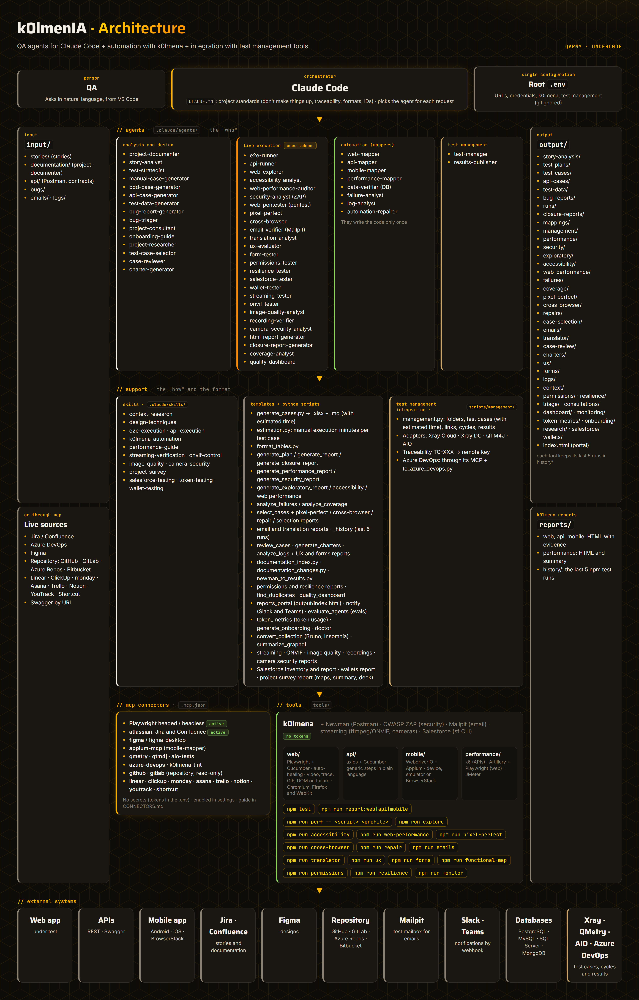
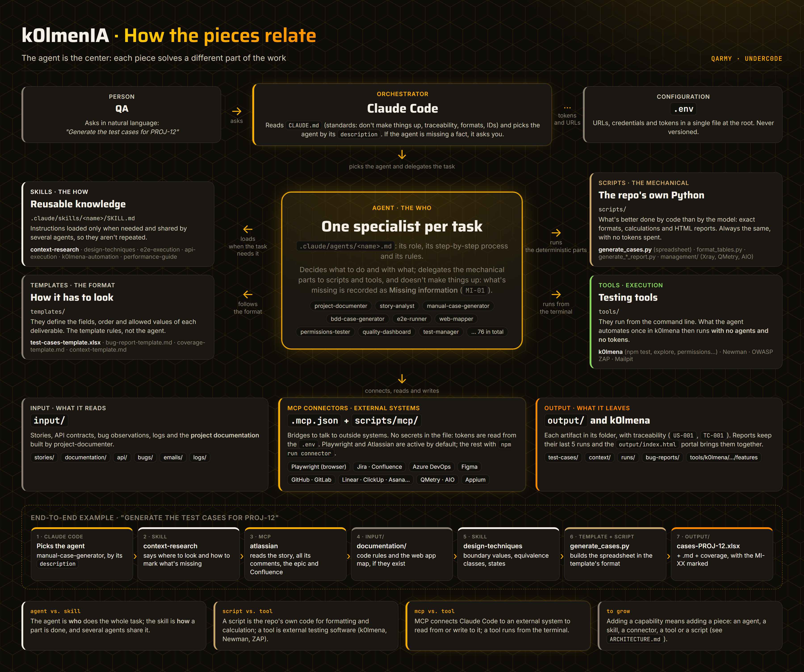
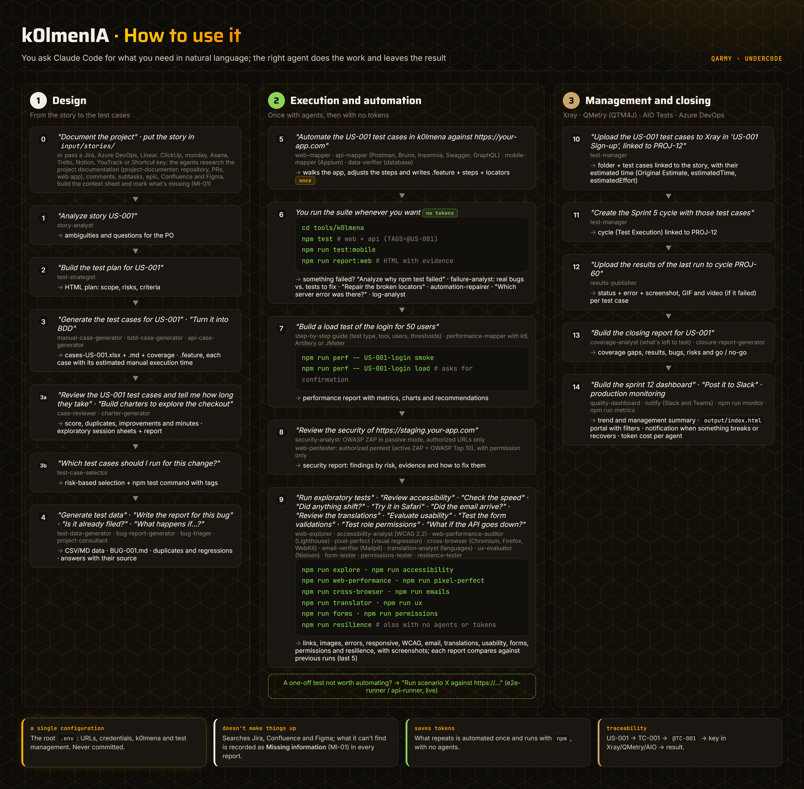

<div align="center">

# 🪖 k0lmenIA

### QA agents for Claude Code

**Design, run and automate tests just by chatting.**<br>
Story analysis, test cases, automation with k0lmena and test management in Xray, QMetry, AIO Tests or Azure DevOps.

<br>

[](#license)
[](#)
[](#-agents)
[](#️-automation-with-k0lmena)
[](https://docs.claude.com/en/docs/claude-code/overview)

**Automation**


**Stack**


**Databases**


**Integrations**


<br>

[**📖 Web documentation**](https://underc0delabs.github.io/k0lmenIA/) · [**📄 PDF documentation**](docs/k0lmenIA-documentation.pdf) · [**🚀 Get started**](#-installation) · [**🌐 qarmy.ar**](https://qarmy.ar) · [**▶️ YouTube**](https://www.youtube.com/@QARMY-UC?sub_confirmation=1) · [**💬 WhatsApp**](https://whatsapp.com/channel/0029VaSzkgD1CYoTmiX8Uv26)

</div>

---

## ✨ What it offers

> Built for manual QAs: no coding required. You work by chatting with Claude Code inside VS Code.

|                                        |                                                                                                                                                                                                                                                                                                         |
| -------------------------------------- | ------------------------------------------------------------------------------------------------------------------------------------------------------------------------------------------------------------------------------------------------------------------------------------------------------- |
| 🧠 **Test design**                      | Analyzes stories, builds the plan, writes manual (Excel), BDD (Gherkin) and API cases, generates data and writes bug reports.                                                                                                                                                                           |
| 🤖 **Token-free automation**            | The *mapper* agents walk through your app **only once** and write the automation in k0lmena. After that it runs with `npm test`, no agents involved.                                                                                                                                                    |
| 🌐 **Web, API, mobile and performance** | Playwright + Cucumber, axios + Cucumber (REST and GraphQL; Postman, Bruno or Insomnia collections), WebdriverIO + Appium (device, emulator or BrowserStack), k6, Artillery and JMeter.                                                                                                                  |
| 📸 **Full evidence**                    | Screenshot (and GIF) of every passing test; video, logs, trace and error of every failing test, in HTML reports.                                                                                                                                                                                        |
| 🗂️ **Test management**                 | Folders, cases, cycles and results with evidence in **Xray** (Cloud and Server/DC), **QMetry (QTM4J)** and **AIO Tests**; cases and suites in **Azure DevOps Test Plans**.                                                                                                                              |
| 🗄️ **Database verification**           | Checks what your tests left stored in **PostgreSQL, MySQL/MariaDB, SQL Server or MongoDB**, on demand or, if you ask for it, as steps inside the tests. Read-only by default.                                                                                                                           |
| 🔌 **Connected**                        | Reads stories from **Jira**, **Azure DevOps**, **Linear**, **ClickUp**, **monday.com**, **Asana**, **Trello**, **Notion**, **YouTrack** or **Shortcut**, the **GitHub, GitLab, Azure Repos or Bitbucket** repository, **Confluence** or Azure DevOps Wiki documentation and **Figma** designs over MCP. |
| 🔎 **Researches before assuming**       | Reads the Jira story with **all its comments, subtasks, epic and linked issues**, plus Confluence and Figma, and builds a context sheet.                                                                                                                                                                |
| 🛡️ **Doesn't make things up**          | Whatever isn't in any source is flagged as **Missing info** (`MI-01`) in every report, with the question for the PO.                                                                                                                                                                                    |

<p align="center">
  
</p>

<p align="center">
  
</p>

<p align="center">
  
</p>

---

## 📚 Contents

- [Agents](#-agents)
- [Requirements](#-requirements)
- [Installation](#-installation)
- [Configuration: the `.env` file](#️-configuration-the-env-file)
- [How to use it](#-how-to-use-it)
- [Context research and "Missing info"](#-context-research-and-missing-info)
- [Project documentation](#-project-documentation)
- [Automation with k0lmena](#️-automation-with-k0lmena)
- [Performance testing](#-performance-testing)
- [Test management: Xray, QMetry, AIO Tests and Azure DevOps](#️-test-management-xray-qmetry-aio-tests-and-azure-devops)
- [Exploratory testing](#-exploratory-testing)
- [Accessibility](#-accessibility)
- [Web performance](#-web-performance)
- [Failure analysis](#-failure-analysis)
- [Coverage and traceability](#-coverage-and-traceability)
- [Change-based case selection](#-change-based-case-selection)
- [Visual regression (pixel perfect)](#️-visual-regression-pixel-perfect)
- [Cross-browser](#-cross-browser)
- [Automation repair](#-automation-repair)
- [Emails](#️-emails)
- [Case review and execution time](#-case-review-and-execution-time)
- [Session-based exploratory testing](#-session-based-exploratory-testing)
- [Usability (Nielsen heuristics)](#-usability-nielsen-heuristics)
- [Forms](#-forms)
- [Permissions by role](#-permissions-by-role)
- [Resilience](#️-resilience)
- [Bug triage and questions](#-bug-triage-and-questions)
- [Logs](#-logs)
- [Translations and languages](#-translations-and-languages)
- [Run history](#-run-history)
- [Quality dashboard and reports portal](#-quality-dashboard-and-reports-portal)
- [Notifications and synthetic monitoring](#-notifications-and-synthetic-monitoring)
- [Agent evals](#-agent-evals)
- [Token usage](#-token-usage)
- [Onboarding](#-onboarding)
- [Web security](#️-web-security)
- [Database verification](#️-database-verification)
- [MCP connectors](#-mcp-connectors)
- [Reference](#-reference): end-to-end flow, conventions, structure, common issues and how to extend it

---

## 🤖 Agents

Claude Code picks the agent based on what you ask for; you can also name it (*"use the web-mapper to…"*). **The full catalog** —when to use each agent, a sample request, which skills, scripts, tools and connectors it uses, what it delivers and what it confirms with you first— is in [`AGENTS.md`](AGENTS.md).

<table>
<tr><th>Family</th><th>Agent</th><th>What it does</th></tr>
<tr><td rowspan="15"><b>🧠 Analysis<br>and design</b></td>
  <td><code>project-documenter</code></td><td>Builds the project documentation in <code>input/documentation/</code>: reads the repository (GitHub, GitLab, Azure Repos or Bitbucket, read-only), the stories with their comments, PRs and links, and builds a functional map of the website</td></tr>
<tr><td><code>story-analyst</code></td><td>Researches the context (comments, subtasks, epic, Confluence, Figma) and detects ambiguities, gaps, risks and Missing info</td></tr>
<tr><td><code>test-strategist</code></td><td>Test plan (scope, risks, types, environment, criteria) in HTML</td></tr>
<tr><td><code>manual-case-generator</code></td><td>Cases in Excel and Markdown + coverage report</td></tr>
<tr><td><code>bdd-case-generator</code></td><td>Gherkin scenarios (English keywords and content) + coverage</td></tr>
<tr><td><code>api-case-generator</code></td><td>Positive, negative, schema and authorization API cases</td></tr>
<tr><td><code>test-data-generator</code></td><td>Valid, invalid and edge data (Markdown or CSV)</td></tr>
<tr><td><code>bug-report-generator</code></td><td>Bug report following your template, with justified severity and priority</td></tr>
<tr><td><code>bug-triager</code></td><td>Before you file a bug, checks whether it already exists in Jira, Azure DevOps or the local bugs, detects regressions of closed bugs and suggests severity, component, assignee and story</td></tr>
<tr><td><code>project-consultant</code></td><td>Ask it how any part of the product works: it answers from the project documentation, citing where each fact comes from or saying it isn't documented</td></tr>
<tr><td><code>onboarding-guide</code></td><td>Onboarding plan for a new QA: the product, its environment, the agents for their role, the first tasks and a checklist</td></tr>
<tr><td><code>project-researcher</code></td><td>Surveys the whole project over MCP (Jira, Azure DevOps, Confluence, repo, Figma) and builds a report for a new QA: what it's about, modules, flows, team, ambiguities and contradictions with their sources, and prioritized questions for the team</td></tr>
<tr><td><code>case-reviewer</code></td><td>Reviews the quality of existing cases: score, issues, duplicates, manual execution time and the improved version</td></tr>
<tr><td><code>charter-generator</code></td><td>Session-based exploration charters (sheets and notes template) and the sessions report</td></tr>
<tr><td><code>test-case-selector</code></td><td>Which cases to run for a change (git, PR, Jira, release notes), prioritized by risk, with the <code>npm test</code> command ready and the uncovered changes</td></tr>
<tr><td rowspan="20"><b>▶️ Live<br>execution</b><br><sub>uses tokens</sub></td>
  <td><code>e2e-runner</code></td><td>Runs cases in a real browser with Playwright MCP, with evidence</td></tr>
<tr><td><code>api-runner</code></td><td>Runs a Postman, Bruno or Insomnia collection with Newman (REST and GraphQL)</td></tr>
<tr><td><code>web-performance-auditor</code></td><td>Load speed with Lighthouse on mobile and desktop: Core Web Vitals, improvement opportunities with the estimated savings and loading sequence</td></tr>
<tr><td><code>accessibility-analyst</code></td><td>WCAG 2.2 audit (axe-core, keyboard, reflow and manual review) with an HTML report: failed criteria, screenshots and how to fix them</td></tr>
<tr><td><code>web-explorer</code></td><td>Exploratory testing: broken links and images, JavaScript and console errors, responsive behavior at several resolutions, with an HTML report and screenshots</td></tr>
<tr><td><code>pixel-perfect</code></td><td>Visual regression against a baseline (or the design): what shifted and by how many pixels, what's missing, what's new and what changed style, with a slider comparator</td></tr>
<tr><td><code>ux-evaluator</code></td><td>Usability with Nielsen's 10 heuristics: automated measurement on desktop and mobile plus manual review of the flows</td></tr>
<tr><td><code>form-tester</code></td><td>Validates every form field without submitting: required fields, lengths, formats, limits and messages</td></tr>
<tr><td><code>permissions-tester</code></td><td>Logs in with each role and builds the matrix of what each one sees and opens (also by direct URL and in the API), compared against the documented rule</td></tr>
<tr><td><code>resilience-tester</code></td><td>Simulates the API failing or being slow, the network dropping and resources not loading, and checks what the user sees: blank screens, silent errors, endless spinners, recovery</td></tr>
<tr><td><code>salesforce-tester</code></td><td>Tests a Salesforce org (sandbox): surveys access (profiles, permissions, OWD, FLS), validations, flows, triggers, Apex coverage and limits with the <code>sf</code> CLI, derives tests and runs them per profile in Lightning. Never production; doesn't touch metadata</td></tr>
<tr><td><code>wallet-tester</code></td><td>Tests digital wallets and payments in sandbox: balance conservation, idempotency, double spending and concurrency, limits, KYC/AML, reconciliation with the gateway and token and card security (PCI). Test money and cards, never real ones</td></tr>
<tr><td><code>shopify-tester</code></td><td>Tests a Shopify store: surveys the storefront (theme, Liquid errors, policies, catalog) and the Admin API (products and stock, markets, shipping, discounts, webhooks) read-only and runs Theme Check; tests checkout with Bogus Gateway or test mode on mobile and desktop</td></tr>
<tr><td><code>wordpress-tester</code></td><td>Tests WordPress and WooCommerce: surveys the storefront, the WooCommerce REST API (outdated plugins and templates, gateways and their mode, shipping, coupons, webhooks, cron) and WP-CLI read-only; tests checkout, test payments, shipping, coupons, emails and roles</td></tr>
<tr><td><code>prestashop-tester</code></td><td>Tests PrestaShop (1.6/1.7/8.x): surveys the storefront and the Webservice API (products, stock, combinations, carriers, zones, currencies, vouchers, multistore and performance config) read-only and, with --local, the version and dev mode; local smoke, checkout, test payments, stock, rounding and performance.</td></tr>
<tr><td><code>vtex-tester</code></td><td>Tests VTEX: storefront, public Catalog System (SKUs, price, stock) and, with a read-only app, sales channels, shipping SLAs and promotions; smoke in a QA workspace, checkout/orderForm, sandbox payments, channels, promos and OMS.</td></tr>
<tr><td><code>sap-tester</code></td><td>Tests SAP (S/4HANA or ECC) in a QA client: SAP GUI (T-codes with the Scripting API) and Fiori/UI5 (OData), authorizations and roles (PFCG/SU53/SoD) and end-to-end O2C/P2P/R2R processes; smoke, regression after transport, performance and security.</td></tr>
<tr><td><code>desktop-tester</code></td><td>Tests Windows desktop apps (WinForms/WPF/UWP/Win32/Electron/Java/Qt): surveys the control tree (pywinauto) and tests with Appium+WinAppDriver, pywinauto or Playwright (Electron); functional, installation, files, OS, regression, performance and security.</td></tr>
<tr><td><code>mobile-tester</code></td><td>Tests mobile apps (Android/iOS; native/hybrid/web) live with Appium: permissions, interruptions, offline, deep links and push, lifecycle, OS and screen compatibility, performance and mobile security (MASVS).</td></tr>
<tr><td><code>dependency-analyst</code></td><td>Dependency SCA (read-only): runs npm audit / pip-audit / osv-scanner, aggregates CVEs by severity, tells direct from transitive and vulnerable from outdated, and flags licenses to review.</td></tr>
<tr><td><code>secure-code-analyst</code></td><td>SAST and secrets (read-only): built-in secret scanner (redacts the value) + semgrep if available, false-positive triage and mapping to OWASP/CWE; complements dynamic analysis (ZAP).</td></tr>
<tr><td><code>ai-tester</code></td><td>Tests AI/LLM features (chatbot, RAG, classifier, agent): golden set and evals, hallucinations and grounding, prompt security (injection/jailbreak), format, robustness, latency and cost.</td></tr>
<tr><td><code>messaging-tester</code></td><td>Tests messaging/events (Kafka/RabbitMQ/SQS/MQTT/WebSocket/SSE): delivery, ordering, idempotency, DLQ and retries, schemas, consumer lag and outbox; publishes/consumes with the tool.</td></tr>
<tr><td><code>soap-tester</code></td><td>Tests SOAP services from the WSDL: operations, XSD validation, SOAP Faults, namespaces/SOAPAction, WS-Security and idempotency; sends the envelopes with api-runner.</td></tr>
<tr><td><code>contract-tester</code></td><td>Contract testing (Pact): consumer-driven and bi-directional for REST, GraphQL, gRPC and events; provider verification, can-i-deploy and compatibility.</td></tr>
<tr><td><code>seo-analyst</code></td><td>SEO and GEO: indexability, on-page, structured data, hreflang and AI crawler access; surveys with npm run seo and hands Core Web Vitals off to the web-performance-auditor.</td></tr>
<tr><td><code>data-tester</code></td><td>Data and pipelines (ETL): quality by dimension, source-target reconciliation, schema validation, transformations and idempotency; read-only with data-verifier.</td></tr>
<tr><td><code>dynamics-tester</code></td><td>Dynamics 365 and other CRM/ERP (sandbox): roles, logic (flows/plugins/BPF/roll-ups) and end-to-end processes; read-only Web API + Playwright per role.</td></tr>
<tr><td><code>blockchain-tester</code></td><td>Blockchain/Web3 and smart contracts (testnet/local): functional, tokens, gas, security (reentrancy, access control, oracles, proxies), Hardhat/Foundry and invariants.</td></tr>
<tr><td><code>ivr-tester</code></td><td>Voice/IVR and voicebots: menu tree (DTMF/voice), prompts, routing and queues, telephony (SIP/VoIP) and compliance (PCI).</td></tr>
<tr><td><code>game-tester</code></td><td>Video games (Unity/Unreal/Godot/HTML5/mobile): mechanics, saving, compatibility, performance, multiplayer, monetization and exploratory testing to break the world.</td></tr>
<tr><td><code>pos-tester</code></td><td>Point of sale (POS) and hardware: sales and cash counts, payments and peripherals, fiscal, offline and reconciliation, register closings.</td></tr>
<tr><td><code>observability-analyst</code></td><td>Analyzes a service's observability: validates logs (trace id, no PII), metrics (Prometheus, RED/USE), traces (OTel), healthchecks (liveness/readiness), SLOs and that alerts fire</td></tr>
<tr><td><code>search-tester</code></td><td>Tests search and relevance (Elasticsearch/Algolia/Solr/DB): ranking, typos, synonyms, facets, indexing and a golden set with metrics (precision@k, nDCG); against QA environments</td></tr>
<tr><td><code>document-tester</code></td><td>Tests generated documents (PDF/Excel/CSV): data and totals, unreplaced placeholders, format/locale, layout, metadata and security; extracts the content with pypdf/openpyxl</td></tr>
<tr><td><code>content-reviewer</code></td><td>Reviews content and typos in the main language: spelling, placeholders, visible i18n keys, duplicated words and microcopy consistency</td></tr>
<tr><td><code>mutation-analyst</code></td><td>Measures the real quality of the test suite with mutation testing (Stryker/mutmut/PITest): mutation score per file, surviving vs. equivalent mutants and which test is missing. A better signal than coverage</td></tr>
<tr><td><code>email-verifier</code></td><td>App emails with a test mailbox (Mailpit): that what's expected arrives, unreplaced variables, links, Outlook and Gmail compatibility, desktop and mobile view</td></tr>
<tr><td><code>translation-analyst</code></td><td>Every page in every language: untranslated text, visible keys, broken characters, truncated text and formats from another region, with the proposed translation</td></tr>
<tr><td><code>cross-browser</code></td><td>Chromium (Chrome, Edge), Firefox and WebKit (Safari): the suite per browser or the pages compared, with what fails or looks different in each one</td></tr>
<tr><td><code>html-report-generator</code></td><td>HTML dashboard of a run</td></tr>
<tr><td><code>closure-report-generator</code></td><td>Closure report with a go/no-go recommendation</td></tr>
<tr><td><code>quality-dashboard</code></td><td>Quality dashboard per sprint or release: passed and trend, % automated, coverage, bugs, flaky tests and a management summary</td></tr>
<tr><td><code>coverage-analyst</code></td><td>Traceability matrix (US → criteria → cases → automation → results) and what's left to test</td></tr>
<tr><td rowspan="9"><b>⚙️ k0lmena<br>automation</b><br><sub>token-free afterwards</sub></td>
  <td><code>web-mapper</code></td><td>Walks through the website following your cases and generates the <code>.feature</code>, steps and locators</td></tr>
<tr><td><code>api-mapper</code></td><td>Reads Postman or Swagger/OpenAPI, verifies the endpoints and generates the <code>.feature</code> files</td></tr>
<tr><td><code>mobile-mapper</code></td><td>Walks through the app with Appium and generates the <code>.feature</code>, steps and locators</td></tr>
<tr><td><code>performance-mapper</code></td><td>Load, stress, soak and spike with k6, Artillery or JMeter; asks for the load and thresholds</td></tr>
<tr><td><code>failure-analyst</code></td><td>When <code>npm test</code> fails: separates real bugs from broken, flaky, data or environment tests, with the evidence</td></tr>
<tr><td><code>log-analyst</code></td><td>Server logs grouped by error and cross-referenced with the scenarios that failed in <code>npm test</code></td></tr>
<tr><td><code>automation-repairer</code></td><td>Repairs broken locators and waits: diagnoses with the DOM saved on failure, proposes a unique locator, applies it with a backup and verifies it</td></tr>
<tr><td><code>data-verifier</code></td><td>Verifies data in PostgreSQL, MySQL/MariaDB, SQL Server or MongoDB and adds DB checks to the tests</td></tr>
<tr><td><code>security-analyst</code></td><td>Passive web security scan with OWASP ZAP and an HTML report with findings, evidence and how to fix them</td></tr>
<tr><td><code>web-pentester</code></td><td>Authorized web pentest (ethical hacking): OWASP ZAP active scan plus manual verification of the OWASP Top 10 with Playwright; confirms each finding and builds the report with steps to reproduce and how to fix. Authorized URLs only, with permission</td></tr>
<tr><td rowspan="2"><b>🗂️ Management</b></td>
  <td><code>test-manager</code></td><td>Folders, cases, links to the story and cycles in Xray, QMetry, AIO Tests or Azure DevOps</td></tr>
<tr><td><code>results-publisher</code></td><td>Uploads the <code>npm test</code> results to the cycle with their evidence</td></tr>
</table>

---

## 📋 Requirements

| To…                           | You need                                                                                                     |
| ----------------------------- | ------------------------------------------------------------------------------------------------------------ |
| Use the agents                | **Claude Code** + a Claude account (Pro, Max, Team or Enterprise) or the Anthropic API. VS Code recommended. |
| Cases, reports and management | **Python 3.10+** (`pip install -r requirements.txt`; on Mac/Linux, `pip3`)                                   |
| Run live E2E                  | **Node.js 20+** (22 LTS recommended) and the Playwright browsers                                             |
| Postman collections           | **Newman**                                                                                                   |
| Automate with k0lmena         | **Node.js 20+** (22 LTS recommended; the Azure DevOps and QMetry connectors need it too)                     |
| Web security (ZAP)            | **Docker** (Docker Desktop)                                                                                  |
| Automate mobile               | **Node.js 22+**, JDK and Android SDK (or macOS with Xcode), or BrowserStack                                  |
| Performance with JMeter       | **Java 8+** (`npm run bootstrap:jmeter` downloads JMeter)                                                    |

---

## 🚀 Installation

```bash
# 1. Claude Code (macOS / Linux; on Windows follow the official guide, below)
curl -fsSL https://claude.ai/install.sh | bash

# 2. The repository (if you already cloned it under another name, go into that folder)
git clone https://github.com/underc0delabs/k0lmenIA.git
cd k0lmenIA
pip install -r requirements.txt   # on Mac/Linux: pip3 install -r requirements.txt
npm install                       # k0lmena (installed in tools/k0lmena)
npm run configure                 # simple questions: your app and your team's tools (creates the .env and enables the connectors)

# 3. Check that everything is ready
npm run doctor                    # tells you what's missing and how to fix it

# 4. Get to work
code .
claude                            # in the VS Code terminal
```

> On Windows the Python command is `python`; on Mac and Linux, `python3` and `pip3`. If `pip3` answers *externally-managed-environment* on Mac, use a virtual environment: `python3 -m venv .venv && source .venv/bin/activate` (`.venv/` is already in `.gitignore`).

<details>
<summary><b>Install the optional pieces</b> (live execution, Newman, k0lmena, k6)</summary>

```bash
npx playwright install                  # live E2E execution
npm install -g newman                   # Postman collections

npm install                             # k0lmena (from the root; installs into tools/k0lmena)
cd tools/k0lmena
npx playwright install chromium
npm run bootstrap:k6                    # API performance with k6
npm run bootstrap:jmeter                # performance with JMeter (needs Java 8+)
```

Claude Code can also be installed with `npm install -g @anthropic-ai/claude-code` (Node.js 22 LTS covers Claude Code and the whole project). Official guide: https://docs.claude.com/en/docs/claude-code/overview
</details>

---

## ⚙️ Configuration: the `.env` file

There is **a single `.env`, at the root**. The agents, k0lmena and the management scripts use it. It is never pushed to the repo; the commented template is [`.env.example`](.env.example).

**The easy way:** `npm run configure`. It asks for your app's URL and which tools your team uses (where the stories live, where you keep the cases, the code and Figma), asks only for those tools' details and enables the connectors. You can run it as many times as you want: Enter keeps what was already there. The table below is for anyone who wants to edit the `.env` by hand.

| Group                  | Variables                                                                                                                                   |
| ---------------------- | ------------------------------------------------------------------------------------------------------------------------------------------- |
| App under test         | `APP_URL` `APP_USER` `APP_PASSWORD`                                                                                                         |
| API                    | `API_TOKEN` `API_BASEURL`                                                                                                                   |
| Web (k0lmena)          | `BROWSER` `HEADLESS` `VIEWPORT_WIDTH` `VIEWPORT_HEIGHT` `LOCALE` `TIMEZONE` (the URL is `APP_URL`)                                          |
| Execution and evidence | `TAGS` `PARALLEL` `EVIDENCE` (`screenshot` · `both` · `off`) `VIDEO` `TRACE` `K0LMENA_AUTO_HEALING`                                         |
| Mobile                 | `MOBILE_TARGET` (`device` · `emulator` · `browserstack`) `MOBILE_PLATFORM` `MOBILE_DEVICE_NAME` `MOBILE_APP` `MOBILE_UDID` `BROWSERSTACK_*` |
| Performance            | `PERF_VUS` `PERF_DURATION` (optional)                                                                                                       |
| Databases              | `DB_CONNECTIONS` + per connection `DB_<NAME>_ENGINE` `_HOST` `_PORT` `_DATABASE` `_USER` `_PASSWORD` (or `_URL`) `_WRITE` `_PRODUCTION`     |
| Management             | `MANAGEMENT_TOOL` `MANAGEMENT_PROJECT` + Xray, QTM4J or AIO credentials                                                                     |
| Azure DevOps (MCP)     | `ADO_ORGANIZATION` `ADO_PAT` `ADO_PROJECT`                                                                                                  |

> [!WARNING]
> Use credentials from a **test** environment. The agents read secrets from the `.env`: never paste a token into the chat.

---

## 💬 How to use it

1. Ask *"Document the project"* to gather the context (repository, stories, links and website) into `input/documentation/`; put your inputs in `input/` (`stories/`, `api/`, `bugs/`), or pass a Jira, Azure DevOps, Linear, ClickUp, monday.com, Asana, Trello, Notion, YouTrack or Shortcut key, a Confluence page or a Figma link.
2. Ask for what you need in natural language.
3. Review the result in `output/` or in `tools/k0lmena/`.

| You ask                                                                               | You get                                                 |
| ------------------------------------------------------------------------------------- | ------------------------------------------------------- |
| *"Document the project"* · *"Gather the context for PROJ-12"*                         | Project base + story dossier in `input/documentation/`  |
| *"Research the context of PROJ-12"*                                                   | Context sheet with sources, findings and Missing info   |
| *"Analyze story US-001"*                                                              | Ambiguities and questions for the PO                    |
| *"Build the test plan for US-001"*                                                    | HTML plan                                               |
| *"Generate the cases for US-001"*                                                     | `cases-US-001.xlsx` + `.md` + coverage                  |
| *"Turn story US-001 into BDD scenarios"*                                              | `US-001-<slug>.feature` + coverage                      |
| *"Generate the cases for the authentication API"*                                     | API cases with their JSON                               |
| *"Take the observation in input/bugs/ and write the report"*                          | `BUG-001.md`                                            |
| *"Is this bug already filed in Jira?"*                                                | Duplicates, possible regressions and suggested severity |
| *"What happens if a blocked user tries to pay?"*                                      | Answer with the source of each fact                     |
| *"Run the valid signup scenario against https://your-app.com"*                        | HTML report of the run with evidence                    |
| *"Test the admin, operator and guest permissions"*                                    | Role × route and role × endpoint matrix                 |
| *"What does the user see if the API goes down or the network is slow?"*               | Page × scenario matrix with screenshots                 |
| *"Automate the US-001 cases in k0lmena against https://your-app.com"*                 | `.feature` + steps + locators                           |
| *"Build a load test of the login for 20 users"*                                       | k6/Artillery/JMeter script + HTML report                |
| *"Check in the database whether user ana@test.com was created and its status"*        | Query and result (read-only)                            |
| *"Add the database check to the signup test"*                                         | DB steps in the `.feature`                              |
| *"Upload the US-001 cases to Xray, linked to PROJ-12, and create the Sprint 5 cycle"* | Cases and cycle in Xray                                 |
| *"Upload the results of the last run to cycle PROJ-60"*                               | Statuses and evidence in the cycle                      |
| *"Build the closure report for US-001"*                                               | Results, bugs and go/no-go                              |
| *"Build the quality dashboard for sprint 12"*                                         | Trend and management summary                            |
| *"Post the result of the last run to Slack"*                                          | Message in Slack or Teams                               |

---

## 🔎 Context research and "Missing info"

Before analyzing, planning, writing cases or automating a story, the agents **research its full context** (skill `context-research`) instead of assuming:

| Source                           | What they check                                                                                       |
| -------------------------------- | ----------------------------------------------------------------------------------------------------- |
| Project documentation            | First: the index and the story dossier that the `project-documenter` builds in `input/documentation/` |
| Jira story                       | Description, criteria, status, labels, components and attachments                                     |
| Comments                         | **All of them**: decisions made later (*"we agreed the limit is 50"*) override the description        |
| Subtasks, epic and linked issues | General rules, sibling stories and known bugs in the flow                                             |
| Confluence and Figma             | Linked or related pages; exact texts, messages and states in the design                               |
| Contracts and `input/`           | Swagger, Postman and local documentation                                                              |

The result is a reusable **context sheet** (`output/context/context-US-XXX.md`) with the sources consulted, the findings per criterion, the decisions and the contradictions. If the story hasn't changed, the other agents reuse it without researching again.

**Whatever doesn't appear in any source is flagged as "Missing info"** with an ID per story (`MI-01`, `MI-02`, …), which travels to every report:

| Where                      | What it looks like                                                                                                                        |
| -------------------------- | ----------------------------------------------------------------------------------------------------------------------------------------- |
| Case spreadsheet (`.xlsx`) | Cases highlighted in amber, `@missing-info` tag, details in Comments and a **Missing info** sheet                                         |
| Coverage and analysis      | **Missing info** section (what's missing, where it was searched, what it affects, question for the PO); criteria `Partial (missing info)` |
| k0lmena `.feature`         | Tags `@missing-info @MI-01` and comment `# MISSING INFO (MI-01): …`                                                                       |
| Mapping report             | Status `Missing info`: the mapper **doesn't use the app to fill in the data**                                                             |
| k0lmena and run reports    | Visible note on the scenario and a warning in the summary                                                                                 |
| Closure report             | **Missing info** section with the open items as risks                                                                                     |
| Xray · QMetry · AIO        | The result comment states that the case depends on missing information                                                                    |

> *"Research the context of PROJ-12 and generate the cases"* → context sheet + cases, with whatever is missing flagged and the questions ready for the PO.

---

## 📚 Project documentation

The **project-documenter** gathers the project's real context and leaves it in `input/documentation/`, so the analyst, the strategist and the case generators work on what actually exists and not on assumptions:

| Source          | What it reads                                                                                                                                               |
| --------------- | ----------------------------------------------------------------------------------------------------------------------------------------------------------- |
| App repository  | README and docs, validations and limits, messages, statuses, roles and permissions, routes, API contracts and the PRs and commits of each story (read-only) |
| Stories         | Jira or Azure DevOps with all their comments, subtasks, epic, links and bugs                                                                                |
| Links           | Confluence, Wiki and Figma with their connector; public pages; private ones are listed as *Not accessible*                                                  |
| The application | `npm run functional-map`: pages, menus, forms with every field, buttons and messages (GET only, without submitting anything)                                |

It produces a **project base** (summary, business rules, messages, statuses and permissions, functional map, API and links), a **dossier per story** (decisions, PRs and code touched, screens, contradictions and testing hints) and an **index** (`INDEX.md`). Every fact carries its source (`src/...:line`, the PR, the comment). The `context-research` skill reads it first, so every agent benefits from it. `input/documentation/` is not versioned.

To read the repository, fill in the *Application repository* block of the `.env` (`REPO_PROVIDER`, `REPO_NAME`, …) and enable its connector: `github` or `gitlab` with `npm run connector`, `azure-devops` for Azure Repos or `atlassian` (with a token) for Bitbucket Cloud. Details in [`CONNECTORS.md`](CONNECTORS.md#application-repository).

**Incremental**: the documenter records what it documented (commit of each repository, sources of each document, date of each story) in `input/documentation/.status.json`. When you ask it to *"Update the documentation"* it redoes only what changed and lists in `changes.md` the cases worth passing to the `case-reviewer`.

> *"Document the project"* · *"Gather all the context for PROJ-12 before writing the cases"*

---

## ⚙️ Automation with k0lmena

[k0lmena](https://github.com/underc0delabs/k0lmena) lives in `tools/k0lmena/`. The *mapper* agents verify your cases against the real app and write the automation **only once**; after that the suite runs as many times as you want, **with no tokens**. The folders come empty: the mappers generate everything for your application.

You can run the commands from the repo root (the root `package.json` delegates them to k0lmena) or inside `tools/k0lmena`:

```bash
npm test                          # web + API
npm run test:web                  # also: test:api · test:mobile · test:all
TAGS=@US-001 npm test             # filter by tag (PowerShell: $env:TAGS="@US-001"; npm test)
npm run report:web                # regenerates the HTML report (npm test already builds it; also: report:api · report:mobile)
```

| Suite    | Passing test                                  | Failing test                                                           |
| -------- | --------------------------------------------- | ---------------------------------------------------------------------- |
| 🌐 Web    | Final screenshot (+ optional GIF)             | Full video, screenshot, error, browser and Node logs, Playwright trace |
| 🔗 API    | Request and response (`Authorization` hidden) | The same + the assertion that failed                                   |
| 📱 Mobile | Final screenshot (+ optional GIF)             | Full video, screenshot, page source and device logs                    |

- `@blocked`: a scenario with a step the mapper couldn't verify; it doesn't run until it's resolved.
- **Saved session**: `npm run login` opens the browser, you log in by hand (works with captcha, 2FA or SSO) and the session is stored in `.auth/`. With `SESSION=yes` in the `.env`, `npm test` and the agents' browser start logged in; `@no-session` skips it in the scenarios that test the login.
- Mobile runs on `device`, `emulator` or `browserstack` depending on `MOBILE_TARGET`; the mobile-mapper needs the Appium MCP connector.
- Extras: `npm run explore` (exploratory crawl with screenshots, videos and a report), `npm run accessibility` (WCAG audit with axe-core), `npm run web-performance` (Lighthouse), `npm run pixel-perfect` (visual regression), `npm run cross-browser` (Chromium, Firefox and WebKit), `npm run repair` (broken locators), `npm run emails` (Mailpit), `npm run translator` (languages), `npm run ux` (heuristics), `npm run forms` (validations), `npm run functional-map` (pages, forms and messages, for the documentation), `npm run permissions` (role matrix), `npm run resilience` (simulated failures), `npm run monitor` (synthetic monitoring), `npm run crawler`, `npm run link-tester`, `npm run record`, `npm run debug` and locator auto-healing.

Details in [`tools/k0lmena/README.md`](tools/k0lmena/README.md).

---

## ⚡ Performance testing

Ask something like *"I want to run a load test of the login"* and Claude **guides you step by step**, one question at a time, with a justified suggestion for each:

1. **Goal and test type**: what you want to find out and which test answers it (load, stress, soak, spike).
2. **Tool**: **k6** (APIs), **Artillery + Playwright** (browser flows) or **JMeter** (if your team already uses it, you bring a `.jmx` or you need other protocols), with a recommendation and the reason for it.
3. **Environment and scope**: URL (never production without authorization), endpoints or steps and their weight.
4. **Load**: concurrent users, ramp-up, duration and think time. If you don't know how many users, it helps you calculate them from the business volume.
5. **Thresholds**: p95, p99 and % errors, from the requirement or with reference values that you confirm.
6. **Plan**: it summarizes it in `output/performance/<US>/` and asks for your confirmation.

Then the **performance-mapper** writes the script, validates it with a smoke run, runs each load test **only when you confirm it** and builds the **performance report**: an HTML dashboard with the verdict, observed capacity, metrics per run, latency, throughput, error and over-time charts, thresholds, p95 per endpoint, findings and **recommendations**. All three tools use the same profiles and the same report format.

```bash
npm run perf                                   # lists the scripts
npm run perf -- <script> smoke                 # validates the script
npm run perf -- <script> load                  # target load (asks for confirmation)
npm run perf -- <script> stress --confirm      # CI or with prior authorization
```

| Profile  | What it does                                |
| -------- | ------------------------------------------- |
| `smoke`  | Minimal load: checks that the script works  |
| `load`   | Sustains the target load                    |
| `stress` | 1x, 2x and 3x: looks for the breaking point |
| `soak`   | Long duration: memory leaks and degradation |
| `spike`  | Sudden spike and recovery                   |

Each run also leaves its own **HTML report** in `tools/k0lmena/reports/performance/` with the verdict, p50/p95/p99 latencies, errors, thresholds and per-endpoint details. If a threshold isn't met, the command exits with an error. The scripts are versioned: you run them again with `npm run perf`, with no agents or tokens.

> [!CAUTION]
> A load test generates real traffic: run it only against test environments or with authorization.

---

## 🗂️ Test management: Xray, QMetry, AIO Tests and Azure DevOps

Set `MANAGEMENT_TOOL` (`xray-cloud` · `xray-dc` · `qtm4j` · `aio`), `MANAGEMENT_PROJECT` and the credentials in the `.env`, and ask:

- *"Upload the US-001 cases to Xray in the folder 'US-001 Signup', linked to PROJ-12"* → **test-manager** creates the folder, uploads the cases and links them to the story.
- *"Create the Sprint 5 cycle with those cases"* → creates the cycle (Test Execution in Xray) linked to the story.
- *"Upload the results of the last run to cycle PROJ-60"* → **results-publisher** loads the status, error and evidence (screenshot, GIF and video if it failed).

Traceability (`output/management/<US>-<tool>.json`) prevents duplicates. There are also manual commands: [`scripts/management/README.md`](scripts/management/README.md).

### Azure DevOps (Test Plans)

Azure DevOps is integrated through its official MCP connector (`azure-devops`), with `ADO_ORGANIZATION`, `ADO_PAT` and `ADO_PROJECT` in the `.env` (see [`CONNECTORS.md`](CONNECTORS.md#azure-devops)):

- *"Read story 1234 from Azure DevOps and analyze it"* → the agents read the work item with its comments, tasks, parent, links and the Wiki.
- *"Upload the cases from `cases-US-001.xlsx` to Azure Test Plans, plan 'Sprint 5', suite 'US-001 Signup', linked to story 1234"* → **test-manager** converts the steps with `scripts/management/to_azure_devops.py`, creates the *Test Cases*, links them to the story and adds them to the suite.

For now the connector doesn't record execution results: **results-publisher** doesn't publish to Azure DevOps yet.

---

## 🔎 Exploratory testing

The **web-explorer** crawls your site (the `APP_URL` in the `.env` or the URL you give it) and looks for what breaks without anyone noticing: **broken links** (internal and external), **images that don't load**, **JavaScript and console errors**, failing resources and **responsive** issues on mobile, tablet and desktop (horizontal scroll, small text, buttons that are too small and too close together), with screenshots at each resolution. Then it explores by hand with Playwright MCP (menus, forms without submitting, searches, the 404 page) and builds the **exploratory report** in HTML.

- *"Run exploratory tests on the site in the .env"*
- *"Look for broken links and responsive issues on https://staging.my-app.com, up to 50 pages"*

A script does the page crawl, without spending tokens per page; you can also run it on its own:

```bash
npm run explore -- --url https://staging.my-app.com --max-pages 50 --resolutions 360x740,768x1024,1366x768
```

It ends up in `output/exploratory/<US or site>/`: the **HTML report** (indicators, charts, every finding with its screenshot, load times, responsive by resolution, videos of the crawl and of each resolution, broken links and the details of each page), the screenshots with the issues marked in red and the videos. Each run **replaces** the previous one. It only navigates with GET: it doesn't submit forms or follow logout links.

---

## ♿ Accessibility

The **accessibility-analyst** audits your site against **WCAG 2.2** (level AA by default). First an automated audit: **axe-core** on every page (contrast, alternative text, labels, button names, language, structure), **keyboard navigation** (elements without visible focus, focus traps, skip to content) and **reflow at 320px**. Then it reviews by hand with Playwright MCP what a tool can't judge: whether the alternative texts are descriptive, the headings, the form error messages, menus and modals with the keyboard and what a screen reader "hears".

- *"Check the accessibility of the site in the .env"*
- *"Audit WCAG AA for the US-001 signup at https://staging.my-app.com/signup"*

The automated audit also runs on its own, with no agents or tokens:

```bash
npm run accessibility -- --url https://staging.my-app.com --level AA --max-pages 20
```

It ends up in `output/accessibility/<US or site>/`: the **HTML report** (compliance, failed WCAG criteria with their name and level, every issue with the affected elements marked in red, how to fix them and the link to the guideline, keyboard navigation and focus order, the manual review and the recommendations), the screenshots and the video. Each run **replaces** the previous one.

> [!NOTE]
> An automated audit detects between 30 and 50 % of accessibility issues. That's why the agent never says the site "complies": it says what doesn't comply and what was left to review.

---

## ⚡ Web performance

The **web-performance-auditor** measures how fast each page loads for a person and why, with **Lighthouse** on mobile and desktop: scores, **Core Web Vitals** (LCP, CLS and TBT) with Google's thresholds, the **improvement opportunities with the estimated savings** and the resources causing them, the LCP element, weight by resource type, third-party code and the loading sequence in screenshots.

- *"Check the speed of the site in the .env"*
- *"Why is the home page slow on mobile?"*

```bash
npm run web-performance -- --url https://staging.my-app.com --max-pages 5 --repetitions 3
```

It ends up in `output/web-performance/<US or site>/`, with the native Lighthouse report for each page. This is lab data (a simulated load): useful for finding and comparing issues. It's not a load test: that's the **performance-mapper**. It needs Node 22.19 or later.

---

## 🧪 Failure analysis

When `npm test` fails, the **failure-analyst** separates **real bugs** from **broken tests**: it classifies each failure (possible bug, locator or wait, environment, test data, automation error, undefined step), reruns the failed ones to detect the **flaky** tests, collects the screenshot, video and trace, writes the bug reports for the real ones and proposes how to fix the rest.

- *"Analyze why npm test failed"*
- *"Which of these failures are bugs?"*

```bash
python scripts/analyze_failures.py                       # analyzes the last run
python scripts/analyze_failures.py --add-retry           # after rerunning the failed ones
```

It ends up in `output/failures/<US or suite>/`. Rerunning the failed tests only happens with your OK, because it runs against the environment.

---

## 🧭 Coverage and traceability

The **coverage-analyst** answers *"what's left for us to test?"*: it cross-references acceptance criteria, manual and BDD cases, k0lmena automation, the management tool, the latest results and the bugs, and flags the **gaps**: criteria without cases, cases not automated, automated cases that are blocked or never ran, failed ones, cases not uploaded to Xray/QMetry/AIO and open missing info.

- *"What's left to test in US-001?"*
- *"Build the traceability matrix for the round"*

```bash
python scripts/analyze_coverage.py --story US-001
```

It ends up in `output/coverage/<US or all>/`: the funnel from story to result, coverage by criterion, the case-by-case matrix and the prioritized gaps.

---

## 🎯 Change-based case selection

The **test-case-selector** answers *"what do I test with this change?"* without running the whole regression: it cross-references what changed (a git range, the files in a PR, Jira or Azure DevOps issues, the release notes) with all the cases —manual, BDD and automated, with their last result, the flaky ones and the open bugs— and builds a selection prioritized by risk: **must-run**, **recommended** and **minimal regression**, each one with its reason, the estimated time and the savings versus running everything.

- *"Which cases do I run for PR #42?"*
- *"Build the regression for release 2.4, I have one hour"*

```bash
python scripts/select_cases.py --git main..release/2.4 --repo ../my-app --name release-2.4 --budget-min 60
```

It ends up in `output/case-selection/<name>/`: the report, the `npm test` command with the tags for the automated part (ready to copy into bash or PowerShell), `selection.csv` with the manual part and the **uncovered changes** (what changed that no case tests). Optional: `input/component-map.json` maps code folders to stories.

---

## 🖼️ Visual regression (pixel perfect)

The **pixel-perfect** agent detects **whether something shifted**: it takes a baseline of every page at every resolution and on each run compares against it, pixel by pixel and element by element. It tells you what moved and by how many pixels, which block shifted and why (what appeared or grew above it), what changed size, text or style, what's missing and what's new. The baseline can also be a Figma design.

- *"Run a visual regression of qarmy.ar"*
- *"Did anything shift in the checkout after the deploy?"*

```bash
npm run pixel-perfect -- --url https://staging.my-app.com      # the first time it creates the baseline
npm run pixel-perfect -- --url https://staging.my-app.com      # afterwards it compares against it
npm run pixel-perfect -- --accept all                          # accepts the changes as the new baseline
```

It ends up in `output/pixel-perfect/<US or site>/`, with a **slider comparator** (baseline ↔ current), the difference map and the before and after of every finding. Areas that change on their own (dates, banners) are hidden with `--hide`.

---

## 🧭 Cross-browser

The **cross-browser** agent finds what works or looks different depending on the browser: **Chromium** (Chrome and Edge), **Firefox** and **WebKit** (Safari's engine), on desktop and mobile. If there is automation, it runs the k0lmena suite in each browser and separates what fails only in some of them (compatibility) from what fails in all of them (bug or broken test); if not, it crawls the pages and compares them against the base browser.

- *"Test US-003 in Chrome, Firefox and Safari"*
- *"Why doesn't the menu work in Safari?"*

```bash
npm run cross-browser -- --story US-003                     # k0lmena suite in the 3 browsers
npm run cross-browser -- --mode pages --url https://staging.my-app.com
```

It ends up in `output/cross-browser/<US, site or suite>/`. Firefox and WebKit are installed once with `cd tools/k0lmena && npx playwright install firefox webkit`. WebKit is a very good approximation, but it doesn't replace a real Safari.

---

## 🔧 Automation repair

The **automation-repairer** fixes tests that fail because **the screen changed**: it extracts from the error the locator that didn't work, tests it against the DOM that k0lmena saves on failure (`reports/web/dom/`) and diagnoses it (no longer exists, matches several elements, exists but isn't visible, the wait failed). It proposes the most robust new locator —checking that it finds a single element—, applies it with a backup and a diff, and reruns the scenarios to confirm they pass. If what's missing is something the case verifies, it doesn't touch the test: it flags it as a possible bug.

- *"Repair the tests that failed because of locators"*
- *"Fix the US-001 automation after the redesign"*

```bash
npm run repair -- --story US-001                 # diagnoses and proposes (touches nothing)
npm run repair -- --apply safe                   # applies the high-confidence ones
npm run repair -- --verify                       # reruns the repaired scenarios
```

It ends up in `output/repairs/<US or suite>/` (with `changes.diff` and `backup/`). Applying what isn't safe and rerunning only happens with your OK.

---

## ✅ Case review and execution time

Every test case carries its **estimated manual execution time**, calculated with a formula (`scripts/estimation.py`, explained in [`templates/time-estimation.md`](templates/time-estimation.md)) based on what each step requires (navigating, filling in fields, waiting for an email, verifying), the preconditions and whether it's a negative case. It appears in the spreadsheet (*Estimated time (min)* column, with the total) and travels to **Xray, QMetry, AIO Tests and Azure DevOps** when the cases are uploaded.

The **case-reviewer** reviews the cases that already exist: it gives them a score, flags vague results, steps without an action, duplicates and stories without negative cases, and proposes the improved version.

- *"Review the US-001 cases"* · *"How long does it take to run the regression by hand?"*

```bash
python scripts/review_cases.py --story US-001
python scripts/estimation.py output/test-cases/manual/cases-US-001.xlsx
```

---

## 🧭 Session-based exploratory testing

The **charter-generator** builds exploration sessions with a goal: each charter has a mission, areas, risks, heuristics, data and a fixed time box. It generates the printable sheets and a notes template per session (`BUG:`, `QUESTION:`, `COVERED:`…); from the notes it builds the report.

```bash
python scripts/generate_charters.py --name US-003              # session sheets
python scripts/generate_charters.py --name US-003 --report     # sessions report
```

---

## 🧩 Usability (Nielsen heuristics)

The **ux-evaluator** reviews usability with **Nielsen's 10 heuristics**: it measures what's repeatable on desktop and mobile (visible technical errors, inconsistent vocabulary, placeholders used as labels, the 404 page…) and walks through the main flows by hand.

```bash
npm run ux -- --url https://staging.my-app.com
```

---

## 📝 Forms

The **form-tester** tests every field **without submitting the form**: required fields, lengths, emails, numbers at the limits, phone numbers, names with accents (which must be accepted), and the error messages from the application or the browser.

```bash
npm run forms -- --url https://staging.my-app.com/signup
```

---

## 🔐 Permissions by role

The **permissions-tester** logs in with each role in the `.env` (plus anonymous), opens every route and endpoint with each one and flags improper access: protected routes open without login, URLs belonging to another role, links that then deny access and APIs without authentication. It compares against the documented rule (the documenter's `statuses-and-permissions.md` or the story); whatever isn't defined is recorded as Missing info. GET only: it doesn't perform actions with side effects.

```bash
npm run permissions -- --url https://staging.my-app.com --endpoints "GET /api/users"
```

---

## 🌩️ Resilience

The **resilience-tester** simulates from the browser that the API responds with an error or doesn't respond, that the network is slow or drops, that empty or broken responses arrive and that styles or scripts don't load. Then it looks at what the user sees: blank screens, silent errors, endless spinners, technical messages and whether the page recovers when the network comes back. It doesn't generate load against the server: it only intercepts.

```bash
npm run resilience -- --url https://staging.my-app.com/products
```

---

## 🐞 Bug triage and questions

- The **bug-triager**, before you file a bug, checks whether it already exists in Jira, Azure DevOps, the local bugs or the repository issues, detects **regressions** of closed bugs and suggests severity, priority, component, assignee and story (`scripts/find_duplicates.py`). Creating or linking in the tool happens only with your confirmation.
- The **project-consultant** answers product questions (*"what happens if a blocked user tries to pay?"*) from the project documentation, citing where each fact comes from or saying it isn't documented.

---

## 🪵 Logs

The **log-analyst** reads the application logs (app, nginx, Apache, JSON, syslog), groups the errors by signature, builds the timeline and cross-references them with the scenarios that failed in `npm test` (each scenario records its start and end) to find the server error behind each failure.

```bash
python scripts/analyze_logs.py --logs "input/logs/*.log" --run web
```

---

## ✉️ Emails

The **email-verifier** checks the emails your application sends —signup, confirmation, password recovery, orders, notifications— with **Mailpit**, a test mailbox that catches them without delivering them to anyone: that what's expected reaches the right person, with no **unreplaced variables** (`{{name}}`, `undefined`), with working **links** (not broken or pointing to `localhost`), visible images, a plain-text version, HTML **compatibility** with Outlook, Gmail and Apple Mail, and how it looks on **desktop and mobile**.

1. Start Mailpit: `docker compose -f tools/mailpit/docker-compose.yml up -d` and point the test app's SMTP to `localhost:1025` (details in [`tools/mailpit/README.md`](tools/mailpit/README.md)).
2. Ask: *"Check that the welcome email reaches ana@test.com"*.

```bash
npm run emails -- --to ana@test.com --expect input/emails/expect-US-001.json
```

It ends up in `output/emails/<US or mailbox>/`. It also adds email steps to the `.feature` files (`Then an email arrives at "ana@test.com" with the subject "Welcome"`), which run with `npm test`.

---

## 🌐 Translations and languages

The **translation-analyst** crawls every page in every language (the first one is the reference) and finds **untranslated text** (also in placeholders and alternative texts), **visible translation keys** (`checkout.add_to_cart`), badly encoded characters (`é`), **truncated text** because the translation is longer, numbers and dates in **another region's format** and the wrong `lang` attribute. It proposes the translation for whatever is missing.

- *"Check the site's translations in Spanish and Portuguese"*

```bash
npm run translator -- --url https://staging.my-app.com --languages en-US,es-AR,pt-BR
```

It ends up in `output/translator/<US or site>/`, with the translated percentage per language and every page in all languages side by side. It switches language with the site's `hreflang` links, with `--language-url` or by asking the browser for it.

---

## 🕒 Run history

Every tool keeps its **last 5 runs** with their evidence in `history/` (inside its output folder; for `npm test`, in `tools/k0lmena/reports/<suite>/history/`) and every report includes the **Run evolution** section: what's new, what was resolved, what remains and how the indicators evolve, with the link to each run's report. That way you can compare, for example, accessibility before and after a fix, or whether a visual regression was already resolved, without losing the evidence from the previous run.

---

## 📊 Quality dashboard and reports portal

- **Quality dashboard**: *"Build the dashboard for sprint 12"* gathers what the tools already left (runs, cases, coverage, bugs, flaky tests) and builds a dashboard with the trend and a management summary in `output/dashboard/<name>/` (`npm run dashboard -- --name sprint-12 --from 2026-10-01 --until 2026-10-14`).
- **Reports portal**: `output/index.html` shows the latest report from every tool, with its date, verdict and the previous run, a search box, filters by tool, story, status and date, and a per-story view (all the reports for a US together). It updates itself every time a report is built and opens with a double-click (`npm run portal -- --open`).

---

## 📣 Notifications and synthetic monitoring

- **Slack and Teams notifications**: `npm run notify -- --title "…" --text "…" --level error` posts through a webhook (`SLACK_WEBHOOK_URL`, `TEAMS_WEBHOOK_URL` in the `.env`); `--from-cucumber tools/k0lmena/reports/web/cucumber-report.json` summarizes an `npm test` run. The triager, the dashboard and the monitoring use it when asked.
- **Synthetic monitoring**: `npm run monitor` runs a **read-only** smoke check (URLs, expected texts, times, TLS certificate and, if you want, k0lmena `@synthetic` scenarios) against any environment, stores the availability in `output/monitoring/<name>/` and **notifies only when something breaks or recovers**. Schedule it with `.github/workflows/monitoring.yml`, cron or the Windows Task Scheduler.

---

## 🧪 Agent evals

The tests cover the scripts; the **evals** (`evals/`) measure the quality of what the agents generate. Each case gives them a story, a contract, an observation or a repository with **deliberate traps** (ambiguities, contradictions, undefined messages, limits, secrets) and verifies with deterministic checks that they flag the Missing info, apply boundary values, respect the templates and don't make things up. They run in an isolated workspace with `claude -p` and leave a report with the score per agent and the **regressions** against the previous run. Use them before and after changing an agent or a skill:

```bash
npm run evals -- --list
npm run evals -- --run --agent manual-case-generator
```

**They spend tokens**: each case is a full conversation, with a cap per case (`--budget-usd`). `--verify-only` checks outputs that were already generated without running the agent again.

---

## 🪙 Token usage

`npm run metrics` reads this project's Claude Code transcripts (counts only, **never the text**), attributes the usage to each agent and builds a report with the estimated cost per agent, day and model, the % read from cache and **opportunities**: the agents that spend the most and the ones used many times for the same thing (candidates to automate in k0lmena, which then runs with no tokens). The quality dashboard includes it.

```bash
npm run metrics -- --name october --from 2026-10-01
```

---

## 🧭 Onboarding

The **onboarding-guide** builds the onboarding plan for a new QA: what the product is (with the documentation and its sources), what its environment looks like (the doctor), which agents help them in their role with sample requests from this project, the tasks for the first weeks with their "done" criteria, the questions for the team and a checklist that is ticked off in the browser.

> *"Build the onboarding for Ana, who's joining as a manual QA"*

---

## 🛡️ Web security

The **security-analyst** reviews your application's security with **OWASP ZAP** (free and open source) in **passive** mode: it crawls the site and analyzes the responses without sending attacks or modifying data. It finds missing security headers, insecure cookies, exposed information, mixed content and other weak configurations.

1. Declare in the `.env` the sites you're allowed to scan (your own or with written authorization): `SECURITY_AUTHORIZED_URLS=https://staging.my-app.com`
2. Open **Docker Desktop** (ZAP runs in a container).
3. Ask: *"Check the security of https://staging.my-app.com for US-001"*.

The agent confirms the URL with you, runs the scan, analyzes the findings (prioritizes them, discards false positives and explains them in plain English) and generates the **security report** in HTML: findings by risk, where each one appears, evidence, how to fix it and prioritized recommendations. It ends up in `output/security/`. Details in [`tools/zap/README.md`](tools/zap/README.md).

> [!IMPORTANT]
> The security-analyst only scans sites authorized in the `.env`, and always in **passive** mode. A passive scan without findings doesn't guarantee the site is secure: it doesn't replace a penetration test.

When you do want an **authorized penetration test**, there's the **web-pentester** (ethical hacking): it tries to break into your platform with the OWASP ZAP **active** scan (it sends attacks) plus manual verification of the **OWASP Top 10** with Playwright (access control and IDOR, authentication and session, injection, XSS, configuration, CSRF/SSRF). It confirms each finding and delivers the report plus a `pentest-report.md` with steps to reproduce and how to fix.

- Ask: *"Try to hack https://staging.my-app.com and send me what you find"*.

> [!WARNING]
> The active pentest is intrusive (it sends attacks and can modify data). It only runs on URLs in `SECURITY_AUTHORIZED_URLS`, with `PENTEST_AUTHORIZED=yes` in the `.env`, on a site that is **your own or with written authorization**, and never against production without that permission. It doesn't do DoS, mass brute force or delete data.

---

## 🗄️ Database verification

The **data-verifier** connects to the databases configured in the `.env` (**PostgreSQL, MySQL / MariaDB, SQL Server and MongoDB**, with several named connections) and verifies whatever you need: what a web or API test stored, whether a piece of data exists, what status a record ended up in.

- *"Check in the database whether user ana@test.com exists and what status it's in"*
- *"Check what test US-003 stored in orders"*
- *"Add the database check to the signup scenario"* → steps that then run with `npm test`, with no tokens:

```gherkin
When I send a POST to "/users" with the body: ...
And I save the response field "id" as "userId"
Then the "users" record where "id" is "{userId}" has:
  | field  | value  |
  | status | ACTIVE |
```

> [!NOTE]
> **Database checks are added to the tests only when you ask for them.** The mappers (web, API and mobile) don't add them on their own: if a case mentions stored data, they leave it as a suggestion in the mapping report. And the data-verifier, when asked a one-off question, answers without touching the `.feature` files.

> [!IMPORTANT]
> **Read-only by default**: queries run in read-only transactions that are discarded, and sensitive columns (passwords, tokens, cards) are masked. To prepare or clean up data, the connection needs `DB_<NAME>_WRITE=yes` and the agent asks for confirmation before each operation; with `DB_<NAME>_PRODUCTION=yes` it never writes. Recommended: a database user with read-only permissions.

It can also be used without an agent: `npm run db -- connections | schema | exists | query` in `tools/k0lmena/`.

---

## 🔌 MCP connectors

| Connector                                                                                 | What for                                                                | Authentication                                                       |
| ----------------------------------------------------------------------------------------- | ----------------------------------------------------------------------- | -------------------------------------------------------------------- |
| `playwright`                                                                              | Browser for the E2E runner and the web-mapper                           | Enabled by default                                                   |
| `atlassian`                                                                               | **Jira and Confluence**: stories, criteria and documentation            | Enabled by default: your account (OAuth) or API token                |
| `figma` · `figma-desktop`                                                                 | Designs from a link to a frame or file                                  | Your account (OAuth)                                                 |
| `appium-mcp`                                                                              | Walk through the app for the mobile-mapper                              | `ANDROID_HOME`                                                       |
| `qmetry` · `qtm4j` · `aio-tests`                                                          | Query the management tool from the chat                                 | API key / token                                                      |
| `azure-devops`                                                                            | **Azure DevOps**: stories, Wiki and cases in Test Plans                 | PAT                                                                  |
| `k0lmena-tmt`                                                                             | Load and query cases in k0lmenaTMT                                      | Personal token                                                       |
| `github` · `gitlab`                                                                       | App repository for the project-documenter                               | Read-only token (GitLab: also OAuth)                                 |
| `linear` · `clickup` · `monday` · `asana` · `trello` · `notion` · `youtrack` · `shortcut` | Stories and documentation if your team doesn't use Jira or Azure DevOps | Your account (OAuth); YouTrack with a token; Asana with your own app |

Your team doesn't use Jira? Stories are read the same way from Linear, ClickUp, monday.com, Asana, Trello, Notion, YouTrack or Shortcut with their official MCP connector (`npm run connector -- activate linear`), and from GitHub or GitLab Issues with the repository connectors.

Claude Code starts right away, without asking you to approve connectors: Playwright and Atlassian (Jira and Confluence) come enabled. Each QA enables the rest according to their team, with one command. None of them carries secrets: credentials are read from the `.env`, which includes a commented block per tool. Full guide in [`CONNECTORS.md`](CONNECTORS.md).

---

**Enable a connector** (for example, Azure DevOps):

```bash
npm run connector                            # lists the connectors and which ones you have enabled
npm run connector -- activate azure-devops   # applies only to you; restart Claude Code
```

`npm run doctor` tells you which variables each enabled connector is missing. Per-tool details in [`CONNECTORS.md`](CONNECTORS.md#what-to-configure-for-your-team).

---

## 📎 Reference

<details>
<summary><b>An end-to-end flow</b></summary>

```
0. "Research the context of PROJ-12"                   → context sheet + Missing info (MI-XX)
1. "Analyze US-001"                                    → questions for the PO
2. "Build the test plan for US-001"                    → HTML plan
3. "Generate the cases for US-001"                     → cases-US-001.xlsx + coverage
4. "Upload the cases to Xray and create the Sprint 5 cycle" → cases and cycle in Xray
5. "Automate the US-001 cases in k0lmena"              → .feature + steps + locators
6. npm test                                            → report with evidence (no tokens)
7. "Upload the results to the Sprint 5 cycle"          → statuses and evidence in Xray
8. "Build a load test of the login"                    → script + performance report
9. "Run exploratory tests on the site in the .env"     → links, images, errors and responsive, with screenshots and video
   "Check the accessibility of the site"               → failed WCAG criteria and how to fix them
   "Check the speed of the site"                       → Core Web Vitals and improvements with their savings
   "Analyze why npm test failed"                       → real bugs vs. tests to fix
   "What's left to test in US-001?"                    → traceability matrix and gaps
10. "Build the closure report for US-001"              → go / no-go
```
</details>

<details>
<summary><b>Conventions</b></summary>

| Element               | Format                                                                                            |
| --------------------- | ------------------------------------------------------------------------------------------------- |
| Stories · criteria    | `US-001` · `AC1`                                                                                  |
| Manual · API cases    | `TC-001` · `TC-API-001`                                                                           |
| Bugs                  | `BUG-001`                                                                                         |
| Missing info          | `MI-01` (per story) · tags `@missing-info @MI-01`                                                 |
| Severity and priority | Critical · High · Medium · Low                                                                    |
| Case status           | N/A · Pending · In progress · Passed · Failed · Blocked                                           |
| Tags in k0lmena       | Feature: `@US-001 @web` · Scenario: `@TC-001` (`@smoke` if critical) · `@blocked`                 |
| Automation            | `<type>/features/US-001-<slug>.feature` · `steps/US-001.steps.ts` · `locators/US-001.locators.ts` |
</details>

<details>
<summary><b>Repository structure</b></summary>

```
k0lmenIA/
├── CLAUDE.md               Context and standards (Claude Code always reads it)
├── AGENTS.md               Agent catalog: skills, tools, connectors and outputs
├── ARCHITECTURE.md         How the repo grows
├── CONNECTORS.md           How to enable the MCP connectors
├── CHANGELOG.md            Changes in each version
├── LICENSE                 MIT license
├── .env.example            Variables template (copy to .env)
├── .mcp.json               MCP connectors (no secrets; enabled according to settings)
├── package.json            Shortcuts to run k0lmena from the root (npm test…)
├── docs/                   Web documentation, PDF and diagrams
├── tests/                  Tests for the repo scripts (pytest and node --test)
├── evals/                  Agent evals: cases with traps, inputs and checks
├── .github/workflows/      CI (tests), synthetic monitoring and evals (manual)
├── .claude/
│   ├── agents/             The 76 agents
│   ├── skills/             Context, design, performance guide, E2E and API execution, k0lmena
│   └── settings.json       Enabled connectors and project permissions
├── input/                  stories/ documentation/ api/ bugs/ (see input/README.md)
├── output/                 What the agents generate (context/, cases, reports, mappings…)
├── templates/              Bug, case spreadsheet, coverage
├── scripts/                Cases, HTML reports, Newman, collector and doctor
│   ├── management/         Xray, QMetry (QTM4J), AIO Tests and cases for Azure DevOps
│   └── mcp/                MCP connector launchers (they read the .env)
└── tools/
    ├── newman/             Postman collections
    ├── zap/                OWASP ZAP: web security (passive scan)
    ├── mailpit/            Mailpit: test mailbox for emails
    └── k0lmena/            web/ api/ mobile/ performance/ reports/
```
</details>

<details>
<summary><b>Common issues</b></summary>

| Issue                                                           | Solution                                                                                                                                                                                   |
| --------------------------------------------------------------- | ------------------------------------------------------------------------------------------------------------------------------------------------------------------------------------------ |
| A new agent doesn't show up                                     | Restart Claude Code.                                                                                                                                                                       |
| The web suite fails with no URL                                 | The root `.env` is missing: `cp .env.example .env` and fill it in.                                                                                                                         |
| `npm test` runs 0 scenarios                                     | You haven't automated anything yet or `TAGS` doesn't match.                                                                                                                                |
| A scenario never runs                                           | It has `@blocked`; the reason is in a comment above it.                                                                                                                                    |
| "k6 not found"                                                  | `npm run bootstrap:k6` in `tools/k0lmena/`.                                                                                                                                                |
| "JMeter not found" / "JMeter needs Java"                        | `npm run bootstrap:jmeter` (or `JMETER_HOME`) and install Java 8+ on the PATH (or `JAVA_HOME`).                                                                                            |
| `npm run perf` won't run a load profile from the agent          | That's on purpose: it needs `--confirm`, which the agent adds after your confirmation.                                                                                                     |
| An Xray/QMetry/AIO folder comes out as `C:/Program Files/Git/…` | In Git Bash, write the folders without a leading `/`.                                                                                                                                      |
| Do the tests always check the database?                         | No: DB checks are added to a `.feature` only when you ask for them; without `DB_CONNECTIONS`, the suite runs the same.                                                                     |
| An MCP connector doesn't connect                                | Run `npm run doctor`: it tells you which variable is missing from the `.env`. Atlassian and Figma are authorized from `/mcp`.                                                              |
| I don't know what I'm missing                                   | `npm run doctor` checks Python, Node, k0lmena, Playwright, Newman, Java, Docker, the fonts, the `.env`, the integrations, the connectors and git (`--section env` to check just one part). |
| An agent returns "I need you to confirm"                        | That's on purpose: agents can't ask questions mid-task. Answer and Claude continues it.                                                                                                    |
</details>

<details>
<summary><b>How to extend the project</b></summary>

- **Agent**: a `.md` in `.claude/agents/` with `name` and `description` (that's what Claude Code uses to decide when to invoke it) and the body in English: role, inputs, process, output and rules.
- **Skill**: a folder in `.claude/skills/` with its `SKILL.md`.
- **Connector**: an entry in `.mcp.json`, without secrets; tokens are read from the `.env` with a script in `scripts/mcp/`.
- **Tool**: a subfolder in `tools/` with its README.
- **Repo tests**: `python -m pytest tests` and `npm run test:repo` (they also run in CI, on Ubuntu and Windows). Add a test when you change a script.
- **Documentation**: the site is [`docs/index.html`](docs/index.html), published at https://underc0delabs.github.io/k0lmenIA/ (GitHub Pages from `docs/`); the diagrams are in `docs/diagrams/`. `node docs/generate.js` regenerates the diagrams and the PDF ([`docs/k0lmenIA-documentation.pdf`](docs/k0lmenIA-documentation.pdf)).

More details in [`ARCHITECTURE.md`](ARCHITECTURE.md).
</details>

---

## License

**MIT** — © 2026 **QARMY**. You can use, modify and share it freely; it is provided without warranty. k0lmena is an open source project by **Danilo Vezzoni**.

<div align="center">
<br>
Made with 🪖 by the <b>Underc0de</b> community
</div>
